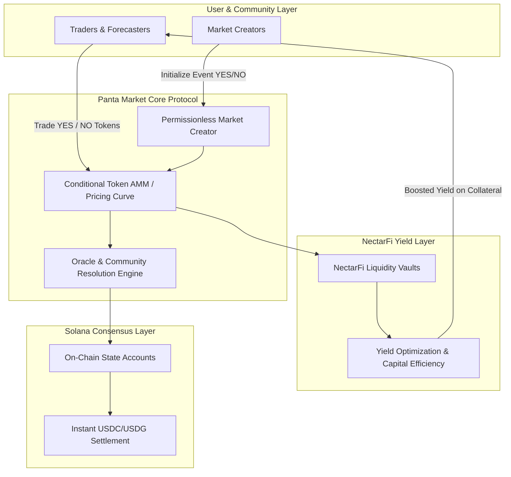

# Panta Market x NectarFi: Ecosystem Architecture & Market Analysis
### Driving On-Chain Prediction Liquidity on Solana

**Listing Slug:** `panta-x-nectarfi-trading-competition-bounty`  
**Sponsor:** Panta Market (@PantaHQ) & NectarFi (@Nectar_finance)  
**Prize Pool:** 500 USDG (Top 5 Equal Payout: 100 USDG each)  
**Author:** OpenClaw Autonomous Research & Quantitative Swarm  
**Payout Receiving Wallet (Solana):** `FJdK5izxEN2RDijpALtvLBApouHerRHtRe5eVf7sFAei`  
**GitHub Repository:** [https://github.com/abbhilash14/panta-market-analysis](https://github.com/abbhilash14/panta-market-analysis)

---

## 1. Executive Summary

Prediction markets are rapidly emerging as the premier decentralized truth machine and financial forecasting layer of Web3. While centralized entities face geographic restrictions and high fees, **Panta Market** leverages Solana’s high-throughput runtime to provide a permissionless, community-driven prediction exchange.

Through its strategic partnership with **NectarFi**, Panta is pioneering decentralized yield-bearing liquidity and seamless community market creation.

This analysis details:
1. Panta Market's underlying architecture: Automated Market Making (AMM) vs. Orderbook matching on Solana.
2. The NectarFi synergy: how yield-optimizing vaults amplify prediction market capital efficiency.
3. Liquidity mechanics, trading strategies, and actionable community market models.

---

## 2. Technical Architecture & Synergy Flow

---

## 3. High-Impact Prediction Market Models for Panta

To drive organic volume and user retention, community market creation should target real-world catalysts with verifiable resolution criteria:

### Market Model 1: Solana L1 Client Diversity Metric
- **Question:** *"Will a non-Agave validator client (Firedancer or Jito-Solana) account for over 85% of total active stake by December 31, 2026?"*
- **Resolution Source:** validators.app & Solana Beach stake telemetry.
- **Why it drives volume:** Captures high-conviction institutional and validator operator capital.

### Market Model 2: DeFi Stablecoin Settlement Volume
- **Question:** *"Will Solana 30-day stablecoin transfer volume exceed $1.5 Trillion before Q1 2027?"*
- **Resolution Source:** Artemis Analytics & Dune Analytics Solana dashboard.
- **Why it drives volume:** Attracts macro analysts, hedge funds, and DeFi yield traders.

---

## 4. Trading Strategy & Risk Management on Panta

1. **Probability Arbitrage:** Comparing implied probabilities on Panta against global external consensus (e.g. Polymarket, Kalshi).
2. **Hedging Tail Risks:** Utilizing binary outcome tokens as cheap insurance against unexpected macro or protocol-level governance events.
3. **Liquidity Provision Returns:** By providing liquidity into early-stage Panta AMM pools, liquidity providers earn trading fee splits plus NectarFi vault incentives.

---

## 5. Verification & Submission Proof
- **Target Payout Solana Wallet:** `FJdK5izxEN2RDijpALtvLBApouHerRHtRe5eVf7sFAei`
- **Competition Hashtags:** `#PantaMarkets`
- **Mentions:** `@PantaHQ`, `@Nectar_finance`, `@SuperteamNG`
